<h1>Hi 👋🏿, I'm Blessed!</h1>

Software and research engineer in Kigali, Rwanda. MS in Information Technology, Carnegie Mellon University, 2026.

### What I research

The data layer for AI agents. Before an agent writes a query, it reads a semantic layer: definitions of what the codes and terms in the data mean. I study whether those definitions match the data, and I am working on checks that catch incorrect ones. [First pilot and its limits](https://www.mblessed.space/blog/semantic-layer-errors).

<picture>
  <source media="(prefers-color-scheme: dark)" srcset="assets/research-map-dark.svg">
  
</picture>

The [interactive map](https://www.mblessed.space) is on my site (Research statement, then Map). Icons: the Isoflow isopacks (MIT, see [attribution](assets/ATTRIBUTION.txt)).

### Selected work

**SLS Energy.** I built a metered billing engine (Python, FastAPI, PostgreSQL) that turns each site's daily energy readings into tariff-based PDF invoices for 9 client organisations. Invoicing went from 15+ days after month-end to two days. Invoices charge only for measured energy: days without a reading are left out, never estimated.

**Athletics anomaly detection (MS thesis).** I crawled 1.58M World Athletics results from 19,712 competitions (2010–2025) and compared 8 statistical and machine-learning detectors against Athletics Integrity Unit sanctions. IEEE SDS 2026, Best Paper Honorable Mention. [Paper](https://ieeexplore.ieee.org/document/11540487) · [arXiv:2604.21953](https://arxiv.org/abs/2604.21953)

**MININFRA (Rwanda's Ministry of Infrastructure).** I architected ClickHouse pipelines and a Grafana dashboard for the national infrastructure intelligence platform, built for planners and investors.

**Sedge ([sedge.app](https://sedge.app)).** I built the Go backend of a text-to-SQL data platform and its query guardrail: one read-only SELECT, allow-listed functions, a 15 s timeout and a 10,000-row cap. It blocked all 61 attack queries written to test it.

**Research results.**
- Semantic-layer pilot on BIRD: with two code meanings swapped in the description an agent reads, all 9 runs across 3 models returned the wrong count, with no warning.
- Hidden rows: under PostgreSQL row-level security, three cheaper models presented partial answers as complete in 70–95% of affected cases. [Report](https://www.mblessed.space/blog/does-an-ai-agent-know-when-it-cannot-see-all-the-data)

### Code

- Data agents: [agent-data-discovery-ladder](https://github.com/blessedmadukoma/agent-data-discovery-ladder) · [inside-an-llm-based-data-agent](https://github.com/blessedmadukoma/inside-an-llm-based-data-agent)
- Earlier study, on whether data agents' logs show what actually ran: [data-agent-traces](https://github.com/blessedmadukoma/data-agent-traces)
- Tools: [comment-ratchet](https://github.com/blessedmadukoma/comment-ratchet) · [go-zeptomail](https://github.com/blessedmadukoma/go-zeptomail) · [golang-web-auth](https://github.com/blessedmadukoma/golang-web-auth) · [next-go-boilerplate](https://github.com/blessedmadukoma/next-go-boilerplate) · [portfolio](https://github.com/blessedmadukoma/portfolio)

### Contact

[mblessed.space](https://www.mblessed.space) · [LinkedIn](https://www.linkedin.com/in/blessed-madukoma) · [blessedmadukoma@gmail.com](mailto:blessedmadukoma@gmail.com)

Outside work, I read, play volleyball, and follow athletics closely enough that it became a research project.
